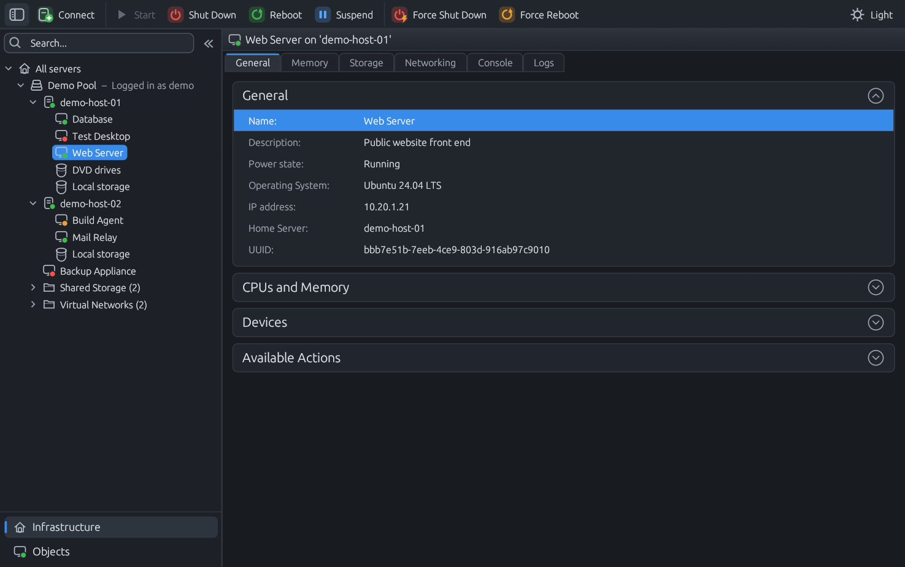

# Simple VM Manager

A small, fast desktop console for **XenServer** and **XCP-ng** pools. Connect to your servers, see their
pools, hosts, virtual machines, storage and networks at a glance, use each VM's screen from its
console, and start, shut down, reboot, suspend or resume virtual machines — in a light or dark theme, on Linux, Windows or macOS.

It is an independent, simpler take on the classic Windows management console layout. It is not
affiliated with or endorsed by the makers of XenServer or XCP-ng.

| Light | Dark |
|---|---|
|  |  |
|  |  |
|  |  |

## Features

- **Servers and pools** — connect to a server by name or IP with your login; pool members redirect to the
  pool coordinator automatically. Earlier servers are remembered (passwords are never saved).
- **Resource tree** — *Infrastructure* view (pool → servers → their VMs and storage; shared storage and
  virtual networks in folders) or *Objects* view (grouped by type), with a search box. The sidebar **folds** into a slim icon strip.
- **Details** — General, Memory, Storage, Networking, Console and Logs tabs for pools, hosts and VMs.
- **Console** — see a running VM's screen and use it with your keyboard and mouse (the keyboard goes
  to the VM while the mouse is over its screen), with *Send Ctrl+Alt+Del*, a *Send keys* menu for the
  combinations your desktop keeps for itself (the Windows key, Alt+Tab…) and *Scale to fit*. It
  reconnects by itself after the VM reboots.
- **VM power actions** — Start, Shut Down, Reboot, Suspend, Resume, Force Shut Down, Force Reboot,
  enabled only when the server allows them, with confirmations for the disruptive ones.
- **Keyboard shortcuts** — Ctrl+B start · Ctrl+E shut down · Ctrl+R reboot · Ctrl+Y suspend/resume ·
  F5 refresh.
- **Light / dark / system theme** — the toolbar's theme button switches light / dark; right-click it to
  follow the system instead. Your choice is remembered.
- **Demo server** — try everything without a real server (*Try the Demo Server* on the Home page).
- Live refresh every 15 s, automatic reconnect.

## Install on Arch Linux / Omarchy

> **Private repository?** Sign in once with GitHub CLI and clone through it instead of `git clone`:
> ```bash
> sudo pacman -S --needed github-cli
> gh auth login
> gh repo clone jpaferreira-git/simple-vm-manager
> ```
> Then continue from `cd simple-vm-manager` below. (Make it public any time with
> `gh repo edit jpaferreira-git/simple-vm-manager --visibility public --accept-visibility-change-consequences`.)

### Option 1 — as a system package (recommended)

```bash
sudo pacman -S --needed git base-devel rust
git clone https://github.com/jpaferreira-git/simple-vm-manager.git
cd simple-vm-manager
makepkg -si
```

This builds the app and installs it with pacman, including the launcher entry and icon. Open it with
**Super + Space** (Omarchy's app launcher) and type *Simple VM Manager*, or run `simple-vm-manager`.

Update later with `git pull && makepkg -si`. Remove with `sudo pacman -R simple-vm-manager`.

### Option 2 — just for your user, no root

```bash
sudo pacman -S --needed git rust pkgconf openssl
git clone https://github.com/jpaferreira-git/simple-vm-manager.git
cd simple-vm-manager
./install.sh            # ./install.sh --uninstall removes it
```

It installs to `~/.local/bin`, `~/.local/share/applications` and `~/.local/share/icons`.

### Option 3 — prebuilt download

Each tagged release has a `simple-vm-manager-linux-x86_64.tar.gz` (built automatically by GitHub
Actions). Unpack it and run `./install.sh` inside: it installs the ready-made program without
building anything. You can also just run `./simple-vm-manager` directly.

### Omarchy / Hyprland tips

- The window reports the app id `simple-vm-manager`, so Hyprland rules can target it, e.g. in
  `~/.config/hypr/hyprland.conf`:
  ```
  windowrulev2 = float, class:^(simple-vm-manager)$
  windowrulev2 = size 1180 740, class:^(simple-vm-manager)$
  ```
- *Same as the system* (right-click the theme button) follows your desktop's light/dark preference; on Omarchy's dark
  themes pick **Dark** if the system setting isn't detected.
- Graphics: it draws with Vulkan (via `vulkan-icd-loader` + your Mesa/NVIDIA driver) and falls back to
  OpenGL automatically.

## Other systems

- **Debian / Ubuntu**: `sudo apt install build-essential pkg-config libssl-dev libxkbcommon-dev libwayland-dev libx11-dev`,
  install Rust from <https://rustup.rs>, then `./install.sh`.
- **Fedora**: `sudo dnf install gcc pkgconf-pkg-config openssl-devel libxkbcommon-devel wayland-devel`, Rust, then `./install.sh`.
- **Windows / macOS**: install Rust from <https://rustup.rs> and run `cargo run --release`.

## Using it

1. Click **Connect** (or the *Connect to a Server* link on the Home page), type the server's name or IP
   address, your user name (usually `root`) and password, and press **Connect**.
2. The server appears in the sidebar. Expand it to see its hosts and virtual machines.
3. Select a VM and use the toolbar or right-click it to start, stop, reboot or suspend it.
   Its **Console** tab shows the VM's screen.
4. Fold the sidebar with the panel button at the far left of the toolbar or the « button next to the
   search box; switch theme with the **Dark / Light** button at the far right.

Settings live in `~/.config/SimpleVMManager/` (Linux/macOS) or `%APPDATA%\SimpleVMManager\` (Windows):
`servers.txt` (server names and user names you used) and `settings.txt` (theme, sidebar).

## How it talks to servers

JSON-RPC over HTTPS on port 443 (`https://<server>/jsonrpc`), logging in with
`session.login_with_password`. Server certificates are accepted without a prompt, so use it on
networks you trust. It re-reads the pool every 15 seconds and right after each action; when a
connection drops it retries after 5 seconds, then every 2 minutes.

## Building from source

```bash
cargo build --release          # binary: target/release/simple-vm-manager
cargo run --release -- --theme dark --sidebar folded
```

Command-line options: `--theme system|light|dark`, `--sidebar open|folded`, and
`--screenshot <file.png> [--show home|objects|vm]` (starts the demo server, saves a picture and exits —
used for automated checks).

Built with Rust, [egui/eframe](https://github.com/emilk/egui) (wgpu renderer with an OpenGL
fallback), `ureq` + `native-tls` for HTTPS.

*Windows note:* with the Rust **GNU** toolchain, a few Windows-only libraries are pinned in
`Cargo.lock`, `build.rs` adds `winlibs/libshlwapi.a`, and you may need a local `.cargo/config.toml`
with `rustflags = ["-C", "dlltool=<path to the toolchain's self-contained dlltool.exe>"]`. The MSVC
toolchain, Linux and macOS need none of this.

## License

MIT — see [LICENSE](LICENSE).
