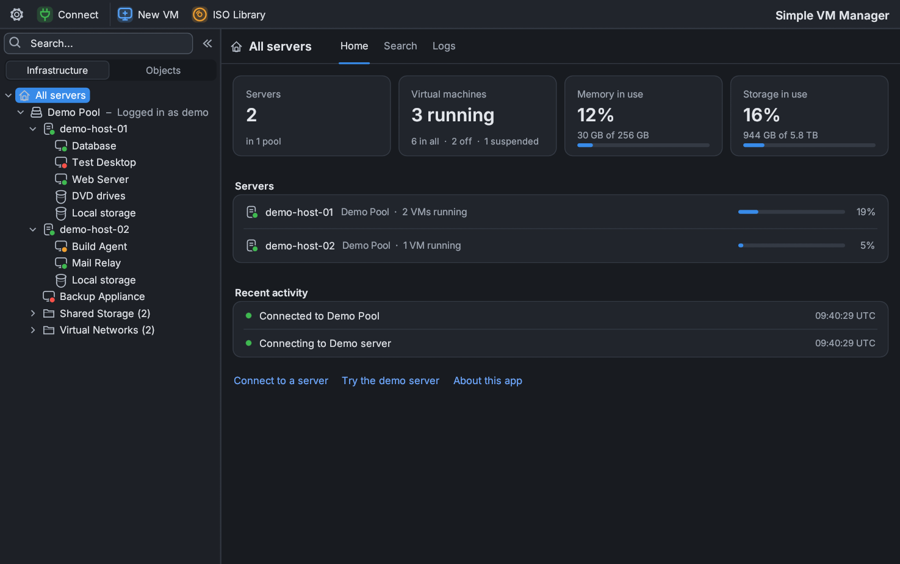
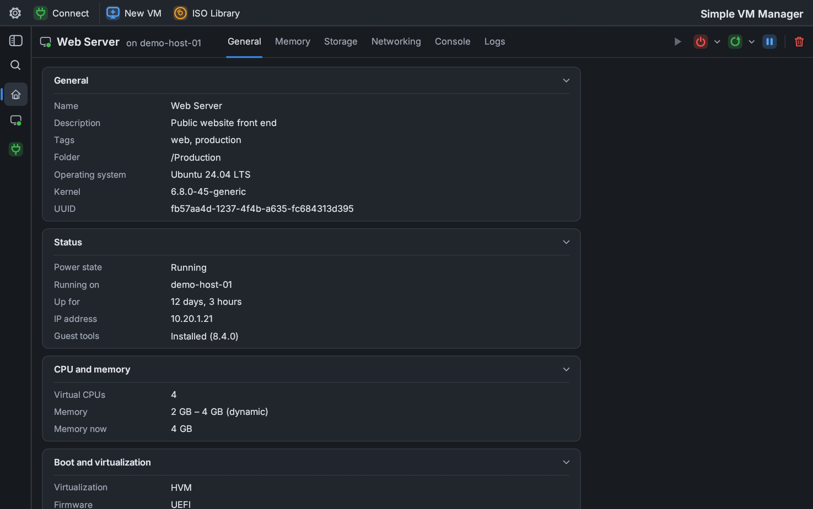
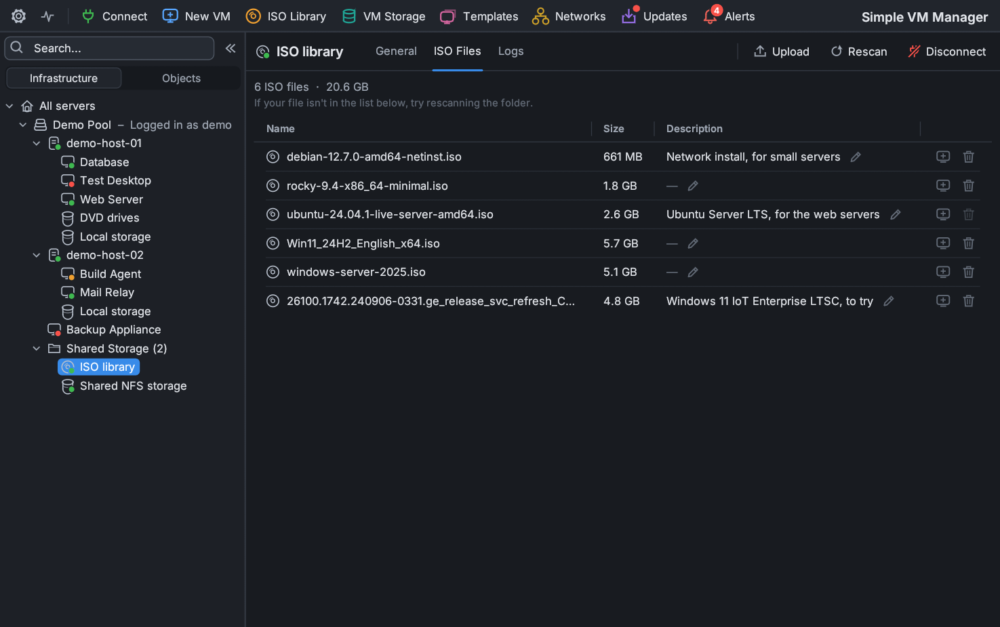
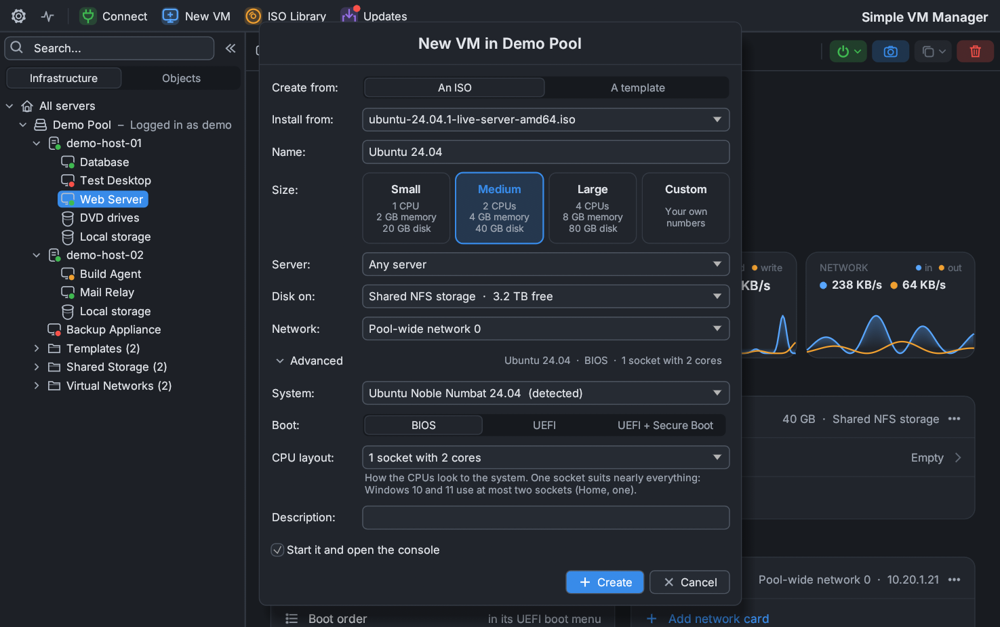

# Simple VM Manager

A small, fast desktop console for **XenServer** and **XCP-ng** pools. Connect to your servers, see their
pools, hosts, virtual machines, storage and networks at a glance, use each VM's screen from its
console, and start, shut down, reboot, suspend or resume virtual machines — in a light or dark theme, on Linux, Windows or macOS.

It is an independent, simpler take on the classic Windows management console layout. It is not
affiliated with or endorsed by the makers of XenServer or XCP-ng.

| Light | Dark |
|---|---|
|  |  |
|  |  |
|  |  |
|  |  |
|  |  |

## Features

- **Servers and pools** — connect to a server by name or IP with your login; pool members redirect to the
  pool coordinator automatically. Earlier servers are remembered. Tick *Remember password* to keep the
  password in your system's keychain (GNOME Keyring, KWallet or KeePassXC on Linux; Credential Manager
  on Windows; Keychain on macOS; never in the app's own files): the app then reconnects to that server
  each time it starts. Right-click a server to *Forget saved password*.
- **Disconnect** — at the end of a pool's (or a lone server's) tabs, or on its right-click menu;
  the app doesn't reconnect to it at the next start.
- **Resource tree** — *Infrastructure* view (pool → servers → their VMs and storage; shared storage and
  virtual networks in folders) or *Objects* view (grouped by type), with a search box. The sidebar **folds** into a slim icon strip.
- **Home overview** — servers, running VMs, memory and storage in use at a glance, each server's load
  and the latest activity.
- **Details** — General, Memory, Storage, Networking and Logs tabs for pools, hosts and VMs, and Console for hosts and VMs.
  A VM's General tab shows its tags, operating system, uptime, IP addresses, guest tools, CPUs and
  memory, firmware and Secure Boot, boot order, high availability, disks and snapshots; click a value
  to copy it.
- **Console** — see a running VM's screen and use it with your keyboard and mouse (the keyboard goes
  to the VM while the mouse is over its screen), always scaled to fit. A keyboard button next to
  the tabs sends Ctrl+Alt+Del and the combinations your desktop keeps for itself (the Windows key,
  Alt+Tab…). It reconnects by itself after the VM reboots. A server has a Console tab too: its own text console
  (the control domain's, as in XenCenter), where you log in as root.
- **ISO libraries** — *ISO Library* on the toolbar adds a Windows (SMB) or NFS share of installation
  discs to a pool: just the address (and a login for SMB) up front, protocol versions under
  *Advanced* (SMB 3.0 and NFSv3 by default). The server mounts the share right away; if that fails
  you get the reason in plain words, the equivalent `xe` command and the server's answer, ready to copy.
  An ISO library shows a disc in the tree and an *ISO Files* tab listing its discs, each with a
  description you can edit in place (kept by the pool, as XenCenter's) and a bin to delete it from
  the share (asks first; a disc in a running VM's DVD drive can't go, and shut-down VMs that have it
  get their drive emptied rather than removed), with *Upload*, *Rescan* (to pick up files copied to
  the share) and *Disconnect* (asks first; the pool stops using it, nothing is deleted). *Upload* takes an .iso from your computer, or straight from a link on the web: the
  link is checked as you paste it (file name and size), and its bytes go through the app into the
  library as they arrive, never saved on your computer. Either way you get progress, speed, time
  left and Cancel; the share must be writable by the account the library uses, and names keep only
  letters, digits, dots and hyphens (the ISO driver's rule). Dropping an .iso on the window uploads
  it too, except on Wayland, where the window toolkit doesn't receive dropped files yet.
- **New VM** — on the toolbar, on a pool's or server's right-click menu, or from an ISO in an ISO
  library: pick the ISO, a size (Small, Medium, Large or your own numbers), the server it runs on
  (or any), where the disk goes (the storage that server sees) and the network (or none). The rest is worked out: the system's template from the ISO's name
  (Windows 11 gets UEFI, Secure Boot and its virtual TPM; an ISO that isn't recognised gets
  "Other install media", plain BIOS), the name ("Ubuntu 24.04"), all CPUs in one socket. Advanced
  has the system, boot mode, CPU layout and a description. It's made the way XenCenter makes
  one, checked first against the storage's free space and the server's CPUs (a yellow note when
  the server hasn't the memory free to start it), and then started with its console open, ready
  to install. The ISO's library, and the disk's storage when it's on the network, are checked as
  they're picked: a NAS that's off doesn't fail, the server waits for it for ever, so a library
  that doesn't answer in 15 seconds shows in a red box ("Minisforum is offline", with Try again)
  and Create waits; they're checked once more when Create is clicked, before anything is made. While it's made, the dialog shows each call to the server and its answer, as in a
  terminal (with Copy), and how long an answer has been awaited; if the server turns something
  down, what was made is undone and its answer stays there. Once made, the dialog can be closed
  while the VM starts (which can take a while). An ISO the app doesn't recognise still gives a
  readable name ("fedora-coreos-44.20260928.3.1-live-iso.x86_64.iso" → "Fedora CoreOS 44").
- **Delete VM** — the bin next to a VM's tabs, or on its right-click menu. It asks first, and its disks go too unless unticked (a disk another VM also uses stays);
  its snapshots go with it, and ISO files in its DVD drive aren't touched. A VM that's on is
  turned off first, the button saying so ("Shut down and delete").
- **Shut down a server** — the red power icon at the end of a server's tabs. It asks first, saying
  which VMs move to the pool's other servers and which are shut down (their disks on that server's
  own storage), and warns when it's the pool's coordinator. Then it goes the way the pool expects:
  no new VMs sent to it, those VMs shut down, the rest moved, then the server; if a step fails it
  takes VMs again.
- **VM power actions** — Start, Shut Down, Reboot, Suspend, Resume, Force Shut Down, Force Reboot,
  enabled only when the server allows them, with confirmations for the disruptive ones. They're
  coloured icons at the right end of a VM's tabs (the Force ones behind the small arrows; on the
  name's line when the window is narrow), and on its right-click menu.
- **Keyboard shortcuts** — Ctrl+B start · Ctrl+E shut down · Ctrl+R reboot · Ctrl+Y suspend/resume ·
  F5 refresh.
- **Settings** — the gear at the far left of the toolbar: the theme (light, dark, or the same as
  your desktop), the size of everything (90–125%; Ctrl + and Ctrl - too), and the saved passwords,
  each with *Forget* (deleted from the keychain; the app stops connecting there as it starts), even
  for a server no longer in the tree. Your choices are remembered.
- **Updates** — as it starts, the app asks GitHub whether there's a newer release (Settings can turn
  this off, or *Check now*). If there is, it offers it: *Update* downloads it, puts it in place of
  the copy in `~/.local/bin` and opens it again; a copy the package manager installed (`/usr/bin`)
  says how to update it instead.
- **Demo server** — try everything without a real server (*Try the Demo Server* on the Home page).
- Live refresh every 15 s, automatic reconnect. A server that's off is given up on after 6 s
  (the window never waits for it); if it's the one the app logs in through, the pool's other
  servers are tried, and if they all point to a coordinator that's off, the app says so and how to
  make another server the coordinator.

## Install on Arch Linux / Omarchy

### Option 1 — as a system package (recommended)

```bash
sudo pacman -S --needed git base-devel rust
git clone https://github.com/jpaferreira-git/simple-vm-manager.git
cd simple-vm-manager
makepkg -si
```

This builds the app and installs it with pacman, including the launcher entry and icon. Open it with
**Super + Space** (Omarchy's app launcher) and type *Simple VM Manager*, or run `simple-vm-manager`.

Update later with `git pull && makepkg -si`. Remove with `sudo pacman -R simple-vm-manager`.

### Option 2 — just for your user, no root

```bash
sudo pacman -S --needed git rust pkgconf openssl
git clone https://github.com/jpaferreira-git/simple-vm-manager.git
cd simple-vm-manager
./install.sh            # ./install.sh --uninstall removes it
```

It installs to `~/.local/bin`, `~/.local/share/applications` and `~/.local/share/icons`.

### Option 3 — prebuilt download

Each tagged release has a `simple-vm-manager-linux-x86_64.tar.gz` (built automatically by GitHub
Actions). Unpack it and run `./install.sh` inside: it installs the ready-made program without
building anything. You can also just run `./simple-vm-manager` directly.

### Omarchy / Hyprland tips

- The window reports the app id `simple-vm-manager`, so Hyprland rules can target it, e.g. in
  `~/.config/hypr/hyprland.conf`:
  ```
  windowrulev2 = float, class:^(simple-vm-manager)$
  windowrulev2 = size 1180 740, class:^(simple-vm-manager)$
  ```
- *Same as the system* (right-click the theme button) follows your desktop's light/dark preference; on Omarchy's dark
  themes pick **Dark** if the system setting isn't detected.
- Graphics: it draws with Vulkan (via `vulkan-icd-loader` + your Mesa/NVIDIA driver) and falls back to
  OpenGL automatically.

## Other systems

- **Debian / Ubuntu**: `sudo apt install build-essential pkg-config libssl-dev libxkbcommon-dev libwayland-dev libx11-dev`,
  install Rust from <https://rustup.rs>, then `./install.sh`.
- **Fedora**: `sudo dnf install gcc pkgconf-pkg-config openssl-devel libxkbcommon-devel wayland-devel`, Rust, then `./install.sh`.
- **Windows / macOS**: install Rust from <https://rustup.rs> and run `cargo run --release`.

## Using it

1. Click **Connect** (or the *Connect to a Server* link on the Home page), type the server's name or IP
   address, your user name (usually `root`) and password, and press **Connect**.
2. The server appears in the sidebar. Expand it to see its hosts and virtual machines.
3. Select a VM and use the icons next to its tabs, or right-click it, to start, stop, reboot or suspend it.
   Its **Console** tab shows the VM's screen.
4. Fold the sidebar with the « button next to the search box (the folded strip's top button opens
   it again); choose the theme under the gear (**Settings**).

Settings live in `~/.config/SimpleVMManager/` (Linux/macOS) or `%APPDATA%\SimpleVMManager\` (Windows):
`servers.txt` (server names and user names you used) and `settings.txt` (theme, sidebar).

## How it talks to servers

JSON-RPC over HTTPS on port 443 (`https://<server>/jsonrpc`), logging in with
`session.login_with_password`. Server certificates are accepted without a prompt, so use it on
networks you trust. It re-reads the pool every 15 seconds and right after each action; when a
connection drops it retries after 5 seconds, then every 2 minutes.

## Building from source

```bash
cargo build --release          # binary: target/release/simple-vm-manager
cargo run --release -- --theme dark --sidebar folded
```

Command-line options: `--theme system|light|dark`, `--sidebar open|folded`, and
`--screenshot <file.png> [--show home|objects|vm]` (starts the demo server, saves a picture and exits —
used for automated checks).

Built with Rust, [egui/eframe](https://github.com/emilk/egui) (wgpu renderer with an OpenGL
fallback), `ureq` + `native-tls` for HTTPS.

*Windows note:* with the Rust **GNU** toolchain, a few Windows-only libraries are pinned in
`Cargo.lock`, `build.rs` adds `winlibs/libshlwapi.a`, and you may need a local `.cargo/config.toml`
with `rustflags = ["-C", "dlltool=<path to the toolchain's self-contained dlltool.exe>"]`. The MSVC
toolchain, Linux and macOS need none of this.

## License

MIT — see [LICENSE](LICENSE).

The app's typeface is [Inter](https://rsms.me/inter/) © The Inter Project Authors, bundled under the
SIL Open Font License 1.1 ([assets/fonts/LICENSE-Inter.txt](assets/fonts/LICENSE-Inter.txt)).
