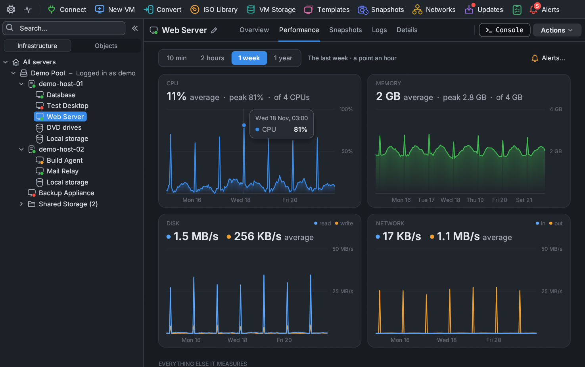
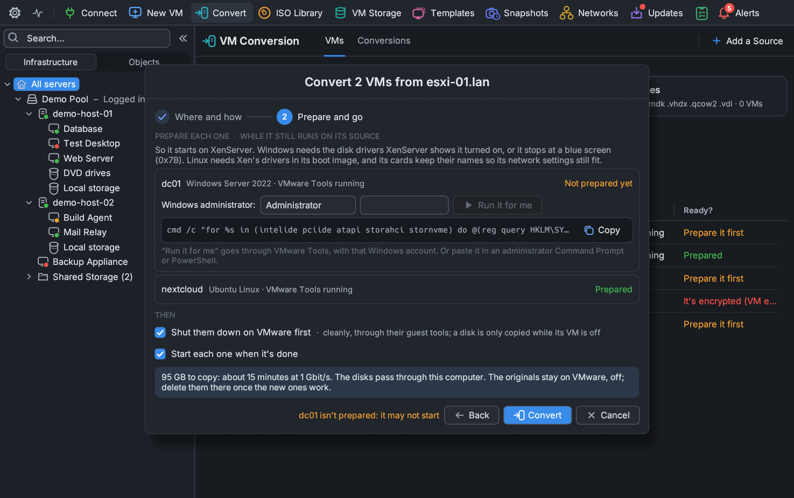
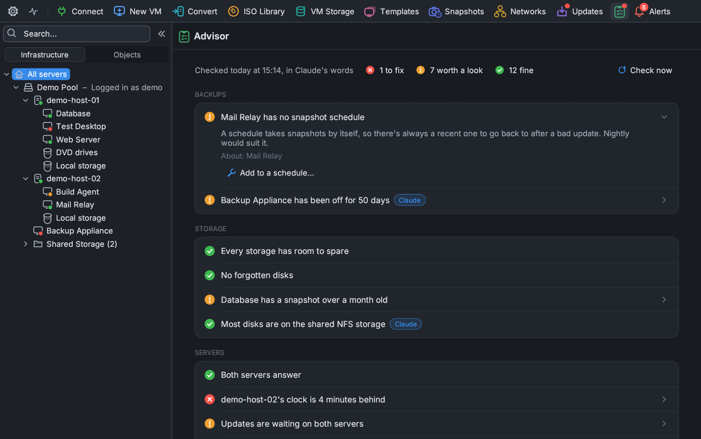

# Simple VM Manager

A small, fast desktop console for **XenServer** and **XCP-ng** pools. Connect to your servers, see their
pools, hosts, virtual machines, storage and networks at a glance, use each VM's screen from its
console, and start, shut down, reboot, suspend or resume virtual machines — in a light or dark theme, on Linux, Windows or macOS.

It is an independent, simpler take on the classic Windows management console layout. It is not
affiliated with or endorsed by the makers of XenServer or XCP-ng. What it does and doesn't do next
to XenCenter, feature by feature: [Simple VM Manager and XenCenter](docs/xencenter-comparison.md).

| | |
|---|---|
|  |  |
|  |  |

## Features

- **Servers and pools** — connect to a server by name or IP with your login; pool members redirect to the
  pool coordinator automatically. Earlier servers are remembered. Tick *Remember password* to keep the
  password in your system's keychain (GNOME Keyring, KWallet or KeePassXC on Linux; Credential Manager
  on Windows; Keychain on macOS; never in the app's own files): the app then reconnects to that server
  each time it starts. Right-click a server to *Forget saved password*.
- **Disconnect** — in a pool's (or a lone server's) *Actions*, at the end of its tabs, or on its right-click menu;
  the app doesn't reconnect to it at the next start.
- **Resource tree** — *Infrastructure* view (pool → servers → their VMs and storage; shared storage in
  a folder; templates and networks have their own pages on the toolbar) or *Objects* view (grouped
  by type), with a search box. The sidebar **folds** into a slim icon strip.
  A dot on each icon says how it's doing: VMs by power state (grey, unknown, while the server
  they run on is off or not answering: nothing can be done to them then); servers green when on,
  red when off or not answering; shared storage and ISO libraries green when mounted, red when their server is
  down (a server's own local storage and removable drives have none). A server that goes
  down without shutting down (power cut, crash) turns red within about half a minute, though the
  pool itself only gives up on it after ten: the app knocks on each server's address as it looks.
- **Home overview** — servers, running VMs, memory and storage in use at a glance, each server's load
  and the latest activity: *All servers*' one tab. A page the toolbar opens (ISO Library, VM
  Storage, Templates, Snapshots, Networks, Alerts) has its own name and its button's icon at the
  top, as does Logs (from Activities' *All of it in Logs*).
- **A VM's Overview** — what matters most, at a glance and to change right there: its name and
  description (each with a pencil), its state in a pill (where it runs, for how long), its system
  and address (to copy); its load over the last ten minutes, live (CPU, memory, disk and network,
  each a little graph); and four cards: **CPUs and memory** (steppers, applied while it's off),
  **Startup** (starts with its server, the boot order of a BIOS VM), **Disks** (add one, grow one,
  remove one; the ISO in its DVD drive, or none) and **Network** (another network for a card, add
  or remove a card); under them **USB** (see below). What can be done while it runs can be; the
  rest says to shut it down first. In a narrow window the graphs go two by two and the cards one
  under another.
- **USB devices** — a USB device plugged into a server can be passed to a VM: a Zigbee or Z-Wave
  stick for Home Assistant, a UPS's cable, a licence dongle. *Add USB device* on the VM's USB card
  lists the pool's devices (those another VM has, or on a server it can't run on, greyed out); the
  VM gets it when it next starts, and from then on starts on that device's server only (it can't
  move to another server while it has it). Its row says which server it's on; its menu takes it
  off (unplugged first while the VM runs). A server's Overview lists its USB devices and the VM
  each is passed to. The VM must be HVM, and a pool whose license leaves this out says so.
- **A server's Overview** — how it's doing (state, time up, address, role, version, CPUs, memory,
  VMs running), its load over the last ten minutes, live (CPU, memory, its VMs' disks, its network
  cards), and four cards: **Capacity** (its memory as a bar: what the server keeps, what its VMs
  have, what's free; the virtual CPUs given out against the real ones), **VMs on this server** (the
  busiest first, each with its CPU's last ten minutes, its CPU now and its memory; a click shows
  it), **Storage** (each one it uses, how full; the shared ones and the pool's default marked so) and **Network** (each card: its traffic now, its
  network, address and speed, the management card marked, an unplugged one said so); and **USB
  devices**, when it has any. Near a limit (memory almost all taken, CPUs busy, more virtual CPUs
  than real ones, storage nearly full) the card turns amber, then red, saying what that means.
- **A server's tools** — in a server's *Actions*:
  - *Restart Toolstack…* starts its management (xapi) again, for when it misbehaves (tasks that
    never end, VMs that won't start or stop); its VMs keep running, and the app connects again
    by itself when it's the coordinator.
  - *Back Up…* saves its system (XenServer as installed there, its settings, the pool's database
    as it has it; not its VMs) in a .xbk file on this computer, under Activities with how far it
    is. *Restore From Backup…* puts one back on its backup partition; started from the XenServer
    installer, it then restores it (the app says how).
  - *Server Status Report…* (also in a pool's *Actions*) gathers each chosen server's logs and settings
    into a .tar.bz2 file, as XenServer's support asks for them, or to look into a problem
    yourself (a snapshot schedule that didn't run, say).
- **Helper VM** (optional) — a small Linux VM in the pool that looks after it, also while the
  app is closed ([helper-vm/](helper-vm/)). It goes through the pool's API, with the servers'
  certificates pinned: nothing is installed on the servers, and it never uses SSH to them. One
  script, `helper-vm/setup.sh`, prepares the VM and asks its questions step by step; a pool's
  *Helper* tab shows how it's doing, and sets where alerts go and what it does by itself. It:
  - sends the pool's alerts to your phone: Telegram, ntfy, Discord, Home Assistant or any
    webhook, as bad as you choose, with quiet hours (only critical ones then); *Send a test*
    has it send one now;
  - tells you when a server stops answering, or the whole pool can't be reached (that one
    straight to your phone);
  - watches any storage's fullness (EXT, XFS, NFS and SMB can't tell XenServer's own monitor),
    services you name (Home Assistant, the NAS…) and the servers' clocks;
  - makes up a snapshot schedule's missed time (XenServer's plugin never does it), mounts shared
    storage again on a server that started before the NAS, and starts VMs in order, with a wait
    between them, when the pool starts;
  - sends a weekly health review of the pool, and checks it every day for the Advisor.

  Claude explains serious alerts, writes the review and words the Advisor's checks. It uses your
  Claude subscription through Claude Code (no extra cost; you sign in by scanning a QR code with
  your phone), or an API key. Claude Code can be installed on the VM, ready to look after the
  pool with you from its terminal.
- **Advisor** — the toolbar's checklist of good practice for each pool, from its Helper VM:
  backups (every VM on a snapshot schedule), storage (room left, forgotten disks, old
  snapshots), servers (answering, clocks, updates, memory), VMs (VM Tools, starting by
  themselves after a power cut) and security (certificates, alerts reaching you). Each check
  says how it went; a click shows why it matters and what to do, in Claude's words, and Claude
  adds five to ten findings of its own, from each VM's and server's details and week's load. Where
  the app can, a button fixes it: turn on *Start with the server*, eject ISOs left in drives,
  delete old snapshots or unused disks (each asked first), or open the dialog that does it (a
  schedule, the updates, a certificate). It's checked once a day; *Check now* asks for it at once.
  When the Helper VM is older than the app, *Update it* has it install the app's version itself.
- **Change Root Password** — in a pool's *Actions*: the root password of every
  server of the pool, after the current one; the app goes on with the new one, and keeps it in the
  keychain when the old one was kept there.
- **Performance** — a VM's or a server's tab with its load over the last **10 minutes, 2 hours,
  week or year**, as its server keeps it (a point every 5 seconds, every minute, every hour, every
  day; nothing is stored on your computer): CPU, memory, disk and network as four charts, each with
  its average and peak, and under the mouse each figure at that time. Below, **everything else it
  measures**, each opened with a click: each CPU, each disk (read and write, requests, how long
  they wait), each network card; on a server also its VMs' CPUs side by side, its load, and each
  storage it uses. A VM made since shows a hatched stretch before its first records. *Performance ›*
  above an Overview's load goes there.
- **A pool's Overview** — one line with its version and its license (green; amber when it runs out
  within 30 days or is a trial; red once it has run out), then its servers' load added up, its
  capacity, its servers (each with its CPU and memory), all its VMs (the busiest first) and its
  storage. When something is wrong (a server off or not answering, storage not mounted, the license
  running out, servers on different versions) its Details tab gets an orange dot and says what,
  under *Needs attention*.
- **Pool updates** — *Updates* on the toolbar, or the Updates item on a pool's Overview: green
  only when every server has every update, yellow when updates are waiting (none for security) or
  a server must still restart for ones installed, red when security updates are waiting (the
  toolbar's dot says the same). For XenServer 8 and later, from the pool's update channel: what's
  waiting (security first, each with its kind, date and what it asks of the server; a click opens
  its page), each server's share, and *Check now* to fetch the latest from the channel. *Install*
  goes server by server, the coordinator first: the pool checked for readiness, the server's VMs
  moved to the others, the updates installed, the server restarted when they need it (or only its
  toolstack) and back before the next. VMs that can't move (on a server's own storage, no room
  elsewhere…) are never shut down unless you choose so: the update then won't start, every server
  checked first, saying which VMs and why; or, if you choose, they're moved with their disks to
  another server and brought back after (slower: their disks are copied twice, but none stops), or
  shut down for their server's restart and started again after. Each step shows as it goes (how long it's been), with every
  call to the servers and their answers below it, as in a terminal (with Copy); a server's restart
  is waited for quietly (going down, then starting up again), and the end says plainly anything
  left to do by hand.
- **Details** — a VM's tabs are Overview, Performance, Snapshots, Logs and Details: the less used
  things (tags, guest tools, virtualization, high availability, every disk and card with its
  position and MAC), then *All fields*: every field the server keeps on it and on its metrics
  (references shown by name, sizes in GB too), read again while the tab is open. A search finds
  any of them (marked where found), a value's click copies it, and *Export* saves it all as a CSV
  spreadsheet or a PDF. Pools and servers have Overview, Storage, Logs and Details, and servers
  Performance too. At the tab row's right end, two buttons: **Console**, and **Actions**, a menu
  of everything it can do, each with its icon (a VM's power actions with their shortcuts, then Take
  Snapshot, Move, Copy VM, Make Template, Export to a File, and Delete VM in red; a server's
  Restart, Shut Down and Maintenance Mode, then its tools, or Power On while it's off). What can't
  be done now is greyed out, saying why. In a window too narrow, Console goes into the Actions
  too. A pool's Actions hold Change Root Password, the status report and Disconnect.
- **Console** — the blue **Console** button by the tabs shows a running VM's screen, to use with
  your keyboard and mouse (the keyboard goes to the VM while the mouse is over its screen), always
  scaled to fit; clicked again, it goes back where you were. While it's shown, *Send keys* in the
  Actions sends Ctrl+Alt+Del and the combinations your desktop keeps for itself (the Windows key,
  Alt+Tab…). It
  reconnects by itself after the VM reboots. A server has a Console too: its own text console (the
  control domain's, as in XenCenter), where you log in as root.
- **The console's clipboard** — *Type the clipboard*, first in *Send keys* (or Ctrl+Shift+V over
  the screen), types the text on your computer's clipboard there, a key for each character, with
  how far it is and *Stop*: for a Linux console, an installer, a login screen (plain letters,
  digits and symbols, as on a US keyboard). A Windows VM with XenServer VM Tools shares its
  clipboard, as with XenCenter: Ctrl+V there pastes yours, and what you copy there comes onto your
  computer's. On a server's console Ctrl+V types the clipboard, text selected with the mouse is
  copied, and the mouse wheel scrolls back through what went by. (A Linux VM's text console keeps
  nothing that went by: the wheel scrolls only what runs in it, a desktop or a terminal program.)
  Settings → Console turns the sharing off; typing the clipboard still works.
- **ISO libraries** — *ISO Library* on the toolbar opens a page with every ISO file of every pool:
  each library as a card (where it is, how many files it has, or that it isn't mounted; a click
  opens it), then all the files by name, with their library when there's more than one, each with
  its description, *New VM* and the bin, as on a library's own page. Next to its tabs are *Upload*
  (asking into which library when there are several), *Rescan* (every library) and
  *New ISO Library*, which adds a Windows (SMB) or NFS share of installation
  discs to a pool: just the address (and a login for SMB) up front, protocol versions under
  *Advanced* (SMB 3.0 and NFSv3 by default). The server mounts the share right away; if that fails
  you get the reason in plain words, the equivalent `xe` command and the server's answer, ready to copy.
  An ISO library shows a disc in the tree and an *ISO Files* tab listing its discs, each with a
  description you can edit in place (kept by the pool, as XenCenter's) and a bin to delete it from
  the share (asks first; a disc in a running VM's DVD drive can't go, and shut-down VMs that have it
  get their drive emptied rather than removed), with *Upload*, *Rescan* (to pick up files copied to
  the share) and *Disconnect* (asks first; the pool stops using it, nothing is deleted). *Upload* takes an .iso from your computer, or straight from a link on the web: the
  link is checked as you paste it (file name and size), and its bytes go through the app into the
  library as they arrive, never saved on your computer. Either way you get progress, speed, time
  left and Cancel; the share must be writable by the account the library uses, and names keep only
  letters, digits, dots and hyphens (the ISO driver's rule). Dropping an .iso on the window uploads
  it too, except on Wayland, where the window toolkit doesn't receive dropped files yet.
  The same actions are on the library's right-click menu.
- **Storage that isn't mounted** — as when a server started while the NAS was off: the storage gets
  a "!" in the tree (red when it's mounted nowhere, orange when only some servers lack it), its
  General tab says where it's missing, and *Repair* (in place of *Rescan*) mounts it again there,
  the coordinator first, explaining in plain words if the share won't answer. If the pool has lost
  its settings for it altogether (XenCenter's *Detach*), *Repair* asks where it is and connects the
  same library again, its discs and their descriptions kept. The app also does this by itself,
  once, when it finds storage unmounted (Settings → Storage); Logs says how it went.
- **VM storage** — *VM Storage* on the toolbar lists every pool's storage for VMs' disks: its kind
  (NFS, local disk…), where it is (the NFS folder, or the server it's in), how full it is, and which
  one is the pool's default, where new VMs' disks go and what suspending and moving VMs use
  (*Make Default* on the others, under the mouse; the pool's Overview marks it too). A pool with no
  shared storage is told what that costs: a VM moves to another server only by copying its disks.
  *New VM Storage* adds a folder an NFS server shares: every server of the pool mounts it, so VMs
  move between servers without their disks being copied, and a pool update can keep them running.
  *Browse* asks the server which folders it shares; the new storage can be made the pool's default
  as it's made. If the address is one of the pool's own VMs (a TrueNAS VM, say) a caution says what
  that means: when its server restarts, every VM with a disk there stops. A failure is explained as
  for an ISO library (an export that doesn't let the servers in as root, a folder that isn't there),
  with the `xe` command and the server's answer.
- **New VM** — on the toolbar, on a pool's or server's right-click menu, or from an ISO in an ISO
  library: pick the ISO, a size (Small, Medium, Large or your own numbers), the server it runs on
  (or any), where the disk goes (the storage that server sees) and the network (or none). The rest is worked out: the system's template from the ISO's name
  (Windows 11 gets UEFI, Secure Boot and its virtual TPM; an ISO that isn't recognised gets
  "Other install media", plain BIOS), the name ("Ubuntu 24.04"), all CPUs in one socket. Advanced
  has the system, boot mode, CPU layout and a description. It's made the way XenCenter makes
  one, checked first against the storage's free space and the server's CPUs (a yellow note when
  the server hasn't the memory free to start it), and then started with its console open, ready
  to install. The ISO's library, and the disk's storage when it's on the network, are checked as
  they're picked: a NAS that's off doesn't fail, the server waits for it for ever, so a library
  that doesn't answer in 15 seconds shows in a red box ("Minisforum is offline", with Try again)
  and Create waits; they're checked once more when Create is clicked, before anything is made. While it's made, the dialog shows each call to the server and its answer, as in a
  terminal (with Copy), and how long an answer has been awaited; if the server turns something
  down, what was made is undone and its answer stays there. Once made, the dialog can be closed
  while the VM starts (which can take a while). An ISO the app doesn't recognise still gives a
  readable name ("fedora-coreos-44.20260928.3.1-live-iso.x86_64.iso" → "Fedora CoreOS 44").
- **cloud-init** — making a VM from a template or a snapshot, *Cloud-init* (under Advanced) sets
  it up on its first start, for systems that have cloud-init (cloud images, or a template made from
  a VM with it): its hostname (from its name, unless you type one) and a user with sudo, a
  password and/or SSH keys; or user-data you write yourself. It goes on a small disk labelled
  CIDATA (cloud-init's NoCloud source, as Xen Orchestra does it), "cloud-init config", attached to
  the new VM: delete it once the VM is set up, as it holds the password.
- **Templates** — a VM's *Actions* (or its right-click menu) have *Make Template…*: a template from the VM, which stays as it is, its disks copied in an instant on their
  own storage. A snapshot has it too, over the Snapshots tab's list (from a snapshot of the disks
  only), so a VM that's on needn't stop; otherwise the VM has to be off, as a copy of a running one is like one after a power
  cut (said when a snapshot was taken while it ran). The dialog reminds you to generalize it first:
  Windows' sysprep; on Linux an empty machine ID and new SSH host keys. *Templates* on the toolbar
  lists your templates (not the built-in ones) of every pool, with when each was made, and New VM
  and Delete (a click opens its page); *New Template* there picks the VM, and one that can't be made a template now (on,
  or busy) gets a yellow note saying why and what to do.
  *New VM* then offers *Create from: An ISO | A template*: from a template, its size as it is or
  other CPUs and memory, its disks copied in an instant where it is or in full onto other storage,
  and its network cards as they are or one on another network.
- **Networks** — *Networks* on the toolbar lists every pool's networks: how each reaches outside
  (*VLAN 10 on eth0*, a card, or private: no card), its bridge, MTU and description. *New Network*
  makes one: on a VLAN of a network card (every server of the pool gets it on its card of that
  name; the tags already on the card are listed, and one that's taken is refused before anything's
  asked) or private (each server's VMs among themselves), with a description (its addresses, say)
  and the MTU under Advanced. A VLAN the server turns down takes the new network away again, and
  the reason is said in plain words with the `xe` commands and the server's answer. The bin at a
  row's end deletes a network (its VLAN off every server's card first); it's off, saying why, for a
  card's own network, or while VMs' or templates' cards are on it.
- **Copy VM** — in the same menu: a VM just like one that's off, with its own disks (an instant copy
  where they are, or in full onto other storage) and new network addresses. Each storage says
  whether it's *thin* (a disk takes only what's written on it: EXT, NFS, SMB…) or *thick* (LVM,
  iSCSI: its whole size), and the dialog says how much the copy takes there.
- **Export and import (.xva)** — *Export to a File…*, in a VM's *Actions* (and its right-click menu),
  saves a VM in one file on this computer, as XenServer and XenCenter write it: its settings and its
  disks, compressed on the server if you like. A running VM keeps running: the app takes a snapshot,
  saves that and deletes it (its disks are then as after a power cut, which it says first). A
  template's row has it too, and so do the Snapshots tab's buttons. *New VM* brings one back with *Create from: A file*
  (or drop a .xva on the window): what's in it is read first (its system, CPUs, memory, disks and
  cards), then its name, server, storage and network are yours to choose, and it can start once
  it's in; a template comes in as a template. Both go under Activities with how much and how fast,
  and *Stop* in their details; a stopped one leaves nothing behind.
- **VM Conversion** — *Convert* on the toolbar brings VMs over from **VMware** (ESXi or vCenter),
  **Proxmox**, or **disk files** (.ova, .ovf, .vmx, .vmdk, .vhd, .vhdx, .qcow2, .vdi, .img; or drop
  one on the window), with no appliance to install and no extra license. *Add a Source* connects
  to a server (its password in your keychain), and its VMs are listed with their system, CPUs,
  memory, disks, boot mode and whether they're ready. Tick some, then *Convert*:
  1. **Where and how:** the server and storage, with how much it takes there (only what's
     written, on thin storage). Each of their networks becomes one of the pool's; a VLAN the pool
     doesn't have is made first. They keep their MAC addresses, and each one gets the template
     that fits its system.
  2. **Prepare and go:** so it starts on XenServer, each VM is prepared while it still runs at its
     source. Windows gets the disk drivers XenServer shows it turned on, and Linux gets Xen's
     drivers in its boot image, with its network cards keeping their names. *Run it for me* does
     it through VMware Tools or Proxmox's guest agent; otherwise *Copy* gives the one-line command
     to paste in the VM. Then the VMs are shut down at their source, made on the pool, their disks
     copied (only the parts that hold something), and started.

  The *Conversions* tab follows each one step by step, with its speed and time left, and *Cancel*,
  *Log* and *Try Again*. One that fails is taken off the pool again, and the originals are never
  changed. The disks pass through this computer, or, with the [Helper VM](helper-vm/), go straight
  from VMware or Proxmox into the pool.
- **Delete VM** — last in a VM's *Actions*, or on its right-click menu. It asks first, and its disks go too unless unticked (a disk another VM also uses stays);
  its snapshots go with it, and ISO files in its DVD drive aren't touched. A VM that's on is
  turned off first, the button saying so ("Shut down and delete").
- **Snapshots** — *Take Snapshot…* in a VM's *Actions* (or its right-click menu) takes one:
  its disks as they are now, named with the date and time unless you name it, and, for a running VM,
  its memory too if you tick it, so that reverting resumes it right where it was. The VM's
  *Snapshots* tab lists them, the newest first: when each was taken, what it holds, a description
  you can edit in place, and "Now" on the one the VM's current state comes from. Pick one (a click
  on its round box or its row: one at a time) and the buttons over the list act on it. *Revert* asks
  first, offers to take a snapshot of now before it, turns the VM off if it's on, puts it back, and
  then leaves it as it was at the time: resumed, started again, or off. *Delete* takes one away,
  with its copies of the disks. *New VM* makes a VM of its own from a snapshot of the disks: its
  disks as they were then (in an instant on their own storage), named after the VM, with its CPUs,
  memory and cards unless you change them. In a narrower window the buttons' words get shorter,
  then go on two lines, and the list drops its Holds and Description columns.
- **Snapshots page and schedules** — *Snapshots* on the toolbar lists every pool's VMs: how many
  snapshots each has, its latest and its oldest (orange past 30 days: an old snapshot slows its
  disks a little and holds on to everything changed since), and the schedule it's on; filters
  (with snapshots, without, on a schedule), a search, and every column sorts. A click opens a VM's
  Snapshots tab; tick several to take a snapshot of each at once, or to put them on a schedule.
  Its tabs are *VMs* (this list) and *Schedules*, which lists each pool's snapshot schedules (XenServer's VMSS): each takes
  its VMs' snapshots by itself, every hour, day or chosen days of the week, keeps the last 1 to 10
  it took (deleting the oldest), with
  their memory or not; turn one on or off, run it now (the camera), edit it, pick its VMs, delete
  it. Each says when it last ran and, when its last run failed, why, as the server's alert said
  (also under Alerts: "Snapshot schedule 'Nightly' couldn't take its snapshots"). Times are
  shown and chosen in this computer's time: the servers run them on their own clock (often UTC),
  which the app reads, and the editor says what the time is there ("your time · 19:45 on the
  servers"). The pool's coordinator looks every 15 minutes; a time missed (it was off then, or the
  schedule was changed after it) waits for the next one. A VM's Snapshots
  tab shows its schedule in a box over the list: blue while it runs, orange when it's paused or its
  last run failed, grey on none (with *Schedule…*), and at its end Run now, Edit and Remove (off
  it) as icons; the snapshots a schedule took have a clock, and the name the server gives them
  ("20261120-1843", its date and time in UTC) shows as the date and time here, as the snapshots you
  take are named. A pool whose license doesn't include schedules says so.
- **Move a VM** — *Move…* in a VM's *Actions* or on its right-click menu, or drag it
  onto a server in the tree: one dialog for the server it goes to (each with its free memory, or
  why it can't take it) and the storage of each of its disks (where it is when that server sees
  it, else that server's own, or the roomiest it sees). Under *After the move*, bars show what's
  in use there now and what the VM adds: the server's memory and CPUs, and the storage (on thin
  storage only what's written on its disks counts). Running, it keeps running: moved live,
  its disks copied as it runs when they change storage (also on the same server); off, its disks
  are copied and swapped in, and it starts on that server from then on. Its DVD drive is emptied
  first when its disc's library isn't seen where it goes. Progress in Activities.
- **Shut down or restart a server** — *Restart…* and *Shut Down…* in a server's *Actions*. Each asks first, saying which VMs move to the pool's other servers and which are
  shut down (their disks on that server's own storage), and warns when it's the pool's coordinator.
  Then it goes the way the pool expects: no new VMs sent to it, those VMs shut down, the rest moved,
  then the server; if a step fails it takes VMs again. A restarting server turns green and ringed
  in the tree, and Activities says when it's back. One that takes more than ten minutes gets a
  yellow note on its Overview (what may be wrong: stuck while starting, or off the network) and is
  listed in Alerts. A server that's on but not taking VMs (as one
  left disabled) says so on its Overview, with *Take VMs again*, and in its pool's Details.
- **Power On** — a server that's off has *Power On* in its *Actions* (and
  *Power On* by its state). The pool's coordinator sends it a Wake-on-LAN signal (set up for it the
  first time), and so does this computer when it's on the same network: that also turns on the
  coordinator itself, or a lone server, whose address the app remembers from the last time it
  answered (even after the app restarts). Activities shows it till it answers; after ten minutes
  its Overview says what may be wrong (Wake-on-LAN off in its firmware or for its network card).
  The server's firmware and network card must have Wake-on-LAN on.
- **Maintenance mode** — *Maintenance Mode…* in a server's *Actions*: it stops taking VMs
  (and, on servers that allow it, stays so across restarts), its VMs move to the pool's other
  servers (those that can't are shut down, said first), and it's marked as XenCenter marks it, so
  both show the same. *Exit maintenance* (by its state, or in its Actions) offers to bring its VMs
  back: moved back live, and the ones shut down started on it again.
- **IP address and DNS** — a server's Overview lists its network cards: the one it's managed
  through, its address and whether it's fixed or from DHCP (the gateway and DNS servers on
  hovering it). The pencil at a card's end changes them, and on the management card its hostname
  too. Typos are caught first (an address on another network, one another card has, a gateway off
  its network), and it warns before changing the address it's reached at: for the pool coordinator
  the app follows it to the new address by itself.
- **VM power actions** — Start, Shut Down, Reboot, Suspend, Resume, Force Shut Down, Force Reboot,
  enabled only when the server allows them, with confirmations for the disruptive ones. They come
  first in a VM's *Actions*, with their coloured icons and shortcuts, the Force ones after a line.
  They're on its right-click menu too.
- **Keyboard shortcuts** — Ctrl+B start · Ctrl+E shut down · Ctrl+R reboot · Ctrl+Y suspend/resume ·
  F5 refresh.
- **Alerts** — the bell on the toolbar, with how many need your attention (red when one is
  critical), opens every pool's alerts, by day: what the servers say (a VM that crashed, a
  certificate or license running out, a limit you set passed) and what the app finds itself (a
  connection lost, a server off or not answering, storage not mounted). *Needs attention* or
  *Everything*, by pool when there are several, and a search. A click opens one: what it says,
  and a way to what it's about (or its Performance tab). A server's certificate running out has
  *Renew*: the server makes itself a new one (and the alert goes). Its X dismisses it on its server, so
  XenCenter stops showing it too; *Dismiss all* does it for those shown. A VM's or a server's page
  shows its own at the top (three, then how many more), with *Dismiss all* under them when there
  are several. **Alerts…** in a VM's or a server's Performance tab, and on a
  storage's page, sets limits the pool watches by itself, also while the app is closed (CPU,
  network, disks, free memory, how full a storage is, each for so many minutes), and can have the
  pool email its alerts. Most kinds of storage (EXT, XFS, NFS, LVM) don't tell the pool how full
  they are, so the pool can't raise that one: the dialog says so, and the app raises it itself
  while it's open ("Local storage on tico is 34% full", found by this app).
- **Activities** — next to the gear: what's under way (a ring turning, with how many), each with its
  server, how long it's been and how far it is (for disks moved or copied, and uploads, how much
  of how much and how fast: "11.7 GB of 20 GB · 110 MB/s"), and the last few that ended. A server
  that stops answering or comes back is noted there too, and Refresh (F5) says how it went,
  servers that don't answer included. Long lines take two. A click on one (or on a row of the Logs
  tab) shows it in full: the server, when, how it went, and every call made to the server with its
  answer or its error, as the server gave it (passwords hidden), ready to copy.
- **Tables** — a click on a column's heading sorts by it (an arrow says which way; again for the
  other way, a third time as it came): sizes by their bytes, dates by time, names with the numbers
  in them as numbers ("VM 2" before "VM 10"), empty ones last. A column's edge in the header can be
  dragged to make it wider or narrower; a double click gives it back its own width. Long jobs (copying
  disks, mounting a share, starting a VM…) run as tasks on the server that the app looks at every
  two seconds: if the server stops answering (a power cut), the job is given up as failed after
  100 seconds, instead of waited on for hours. What was being made then (a VM, a copy, a template)
  is noted, even across closing the app; once the server's back, anything left half made under its
  name is offered for deleting. A dialog whose job can't be cancelled says *Close*, not *Cancel*:
  closing it leaves the job going, under Activities. Closing the app doesn't stop a job that's one
  task on the server (copying a VM, a snapshot, moving a running VM): the server finishes it. Only
  when something would be left half done (the app takes it through several steps: a new VM, a
  shut-down VM's disks moved, a revert, a pool's update, a server shut down, a VM deleted, an
  upload) it asks first, with a yellow note for each saying what would be left.
- **Closing the app** — it logs out of each server as it closes, rather than leaving its sessions
  for the servers to drop a day later.
- **Settings** — the gear at the far left of the toolbar: the theme (light, dark, or the same as
  your desktop), the size of everything (90–125%; Ctrl + and Ctrl - too), whether the consoles
  share the clipboard, and the saved passwords,
  each with *Forget* (deleted from the keychain; the app stops connecting there as it starts), even
  for a server no longer in the tree. Your choices are remembered.
- **Updates** — as it starts, the app asks GitHub whether there's a newer release (Settings can turn
  this off, or *Check now*). If there is, it offers it: *Update* downloads it, puts it in place of
  the copy in `~/.local/bin` and opens it again; a copy the package manager installed (`/usr/bin`)
  says how to update it instead.
- **Demo server** — try everything without a real server (*Try the Demo Server* on the Home page).
- Live refresh every 15 s, automatic reconnect. A server that's off is given up on after 6 s
  (the window never waits for it); if it's the one the app logs in through, the pool's other
  servers are tried, and if they all point to a coordinator that's off, the app says so and how to
  make another server the coordinator.

## Install on Arch Linux / Omarchy

### Option 1 — as a system package (recommended)

```bash
sudo pacman -S --needed git base-devel rust
git clone https://github.com/jpaferreira-git/simple-vm-manager.git
cd simple-vm-manager
makepkg -si
```

This builds the app and installs it with pacman, including the launcher entry and icon. Open it with
**Super + Space** (Omarchy's app launcher) and type *Simple VM Manager*, or run `simple-vm-manager`.

Update later with `git pull && makepkg -si`. Remove with `sudo pacman -R simple-vm-manager`.

### Option 2 — just for your user, no root

```bash
sudo pacman -S --needed git rust pkgconf openssl
git clone https://github.com/jpaferreira-git/simple-vm-manager.git
cd simple-vm-manager
./install.sh            # ./install.sh --uninstall removes it
```

It installs to `~/.local/bin`, `~/.local/share/applications` and `~/.local/share/icons`.

### Option 3 — prebuilt download

Each tagged release has a `simple-vm-manager-linux-x86_64.tar.gz` (built automatically by GitHub
Actions). Unpack it and run `./install.sh` inside: it installs the ready-made program without
building anything. You can also just run `./simple-vm-manager` directly.

### Omarchy / Hyprland tips

- The window reports the app id `simple-vm-manager`, so Hyprland rules can target it, e.g. in
  `~/.config/hypr/hyprland.conf`:
  ```
  windowrulev2 = float, class:^(simple-vm-manager)$
  windowrulev2 = size 1180 740, class:^(simple-vm-manager)$
  ```
- *Same as the system* (right-click the theme button) follows your desktop's light/dark preference; on Omarchy's dark
  themes pick **Dark** if the system setting isn't detected.
- Graphics: it draws with Vulkan (via `vulkan-icd-loader` + your Mesa/NVIDIA driver) and falls back to
  OpenGL automatically.

## Other systems

- **Debian / Ubuntu**: `sudo apt install build-essential pkg-config libssl-dev libxkbcommon-dev libwayland-dev libx11-dev`,
  install Rust from <https://rustup.rs>, then `./install.sh`.
- **Fedora**: `sudo dnf install gcc pkgconf-pkg-config openssl-devel libxkbcommon-devel wayland-devel`, Rust, then `./install.sh`.
- **Windows / macOS**: install Rust from <https://rustup.rs> and run `cargo run --release`.

## Using it

1. Click **Connect** (or the *Connect to a Server* link on the Home page), type the server's name or IP
   address, your user name (usually `root`) and password, and press **Connect**.
2. The server appears in the sidebar. Expand it to see its hosts and virtual machines.
3. Select a VM and use the icons next to its tabs, or right-click it, to start, stop, reboot or suspend it.
   Its **Console** button shows the VM's screen.
4. Fold the sidebar with the « button next to the search box (the folded strip's top button opens
   it again); choose the theme under the gear (**Settings**).

Settings live in `~/.config/SimpleVMManager/` (Linux/macOS) or `%APPDATA%\SimpleVMManager\` (Windows):
`servers.txt` (server names and user names you used) and `settings.txt` (theme, sidebar).

## How it talks to servers

JSON-RPC over HTTPS on port 443 (`https://<server>/jsonrpc`), logging in with
`session.login_with_password`. Server certificates are accepted without a prompt, so use it on
networks you trust. It re-reads the pool every 15 seconds and right after each action; when a
connection drops it retries after 5 seconds, then every 2 minutes.

## Building from source

```bash
cargo build --release          # binary: target/release/simple-vm-manager
cargo run --release -- --theme dark --sidebar folded
```

Command-line options: `--theme system|light|dark`, `--sidebar open|folded`, and
`--screenshot <file.png> [--show home|objects|vm]` (starts the demo server, saves a picture and exits —
used for automated checks).

Built with Rust, [egui/eframe](https://github.com/emilk/egui) (wgpu renderer with an OpenGL
fallback), `ureq` + `native-tls` for HTTPS.

*Windows note:* with the Rust **GNU** toolchain, a few Windows-only libraries are pinned in
`Cargo.lock`, `build.rs` adds `winlibs/libshlwapi.a`, and you may need a local `.cargo/config.toml`
with `rustflags = ["-C", "dlltool=<path to the toolchain's self-contained dlltool.exe>"]`. The MSVC
toolchain, Linux and macOS need none of this.

## License

MIT — see [LICENSE](LICENSE).

The app's typeface is [Inter](https://rsms.me/inter/) © The Inter Project Authors, bundled under the
SIL Open Font License 1.1 ([assets/fonts/LICENSE-Inter.txt](assets/fonts/LICENSE-Inter.txt)).
